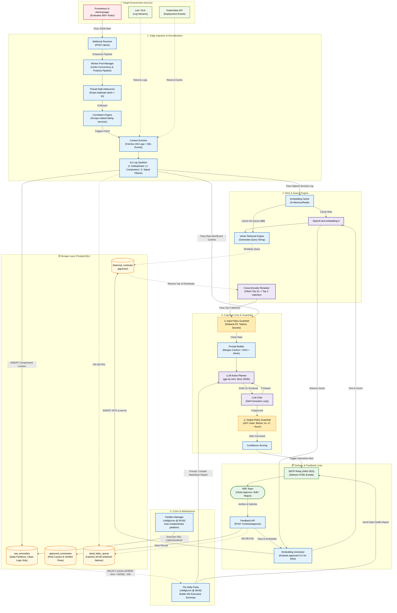

# WatchTower



> **New here?** Two companion volumes:
> - [`docs/book/`](docs/book/README.md) — 25 parts explaining every technology from zero and every
>   architectural decision, ending with an interview playbook. Assumes basic Go and nothing else.
> - [`docs/tutorial-build/`](docs/tutorial-build/README.md) — 20 parts, 100 commits, rebuilding this
>   project from an empty directory in dependency order.

AI-assisted alert triage for SRE teams. An Alertmanager webhook comes in, WatchTower
groups the related alerts, pulls the logs and cluster events around them, strips the
noise and the secrets, retrieves runbooks that previously fixed something similar,
asks a model for a remediation plan, has a second model tear that plan apart, refuses
any dangerous command, scores its own confidence, and emails an on-call engineer a
runbook with Approve / Edit / Reject buttons. What gets approved becomes retrieval
material for the next incident.

Every box in that description is an interface with at least two implementations, and
the default set needs no infrastructure: `go run ./cmd/watchtowerd` gives you the
whole pipeline with in-memory storage, a rule-based planner and email printed to the
terminal.

## Quickstart

```bash
go build -o bin/watchtowerd ./cmd/watchtowerd
./bin/watchtowerd

# in another shell
curl -X POST http://localhost:8080/alerts \
  -H "Content-Type: application/json" \
  --data-binary @examples/alerts/alertmanager-oom.json
```

The service prints the triage email, including signed approval links. Clicking the
approve link (or `POST /runbook/approve`) stores the runbook and embeds it, so the
next similar alert retrieves it.

## The real stack

`docker compose up --build` runs the whole thing against real infrastructure, with no
cloud account and no API key:

| Service | What it does | Where |
| --- | --- | --- |
| Prometheus | Evaluates real alert rules against real (failing) scrape targets | http://localhost:9090 |
| Alertmanager | Posts a real webhook to `/alerts` | http://localhost:9093 |
| Loki | Real log storage, queried with real LogQL for enrichment | http://localhost:3100 |
| log-pusher | Stands in for the failing app, pushes realistic lines to Loki | — |
| Postgres + pgvector | Partitioned incident storage and the runbook corpus | localhost:5432 |
| Ollama | Serves `qwen2.5:1.5b` for planning/critique and `nomic-embed-text` for embeddings over the OpenAI-compatible API | http://localhost:11434 |
| Redis | Shared debounce gate and embedding cache | localhost:6379 |
| Mailpit | Real SMTP, read the delivered emails in a browser | http://localhost:8025 |

Nothing needs poking. Prometheus scrapes two targets that do not exist, so `up == 0`
makes the rules fire about thirty seconds after startup, Alertmanager posts the group
to WatchTower, and an email lands in Mailpit a minute or two later (CPU inference on a
1.5B model is the slow part).

Swapping in real cloud models is two variables, because the same adapter serves both:

```bash
WT_LLM_BASE_URL=https://api.openai.com/v1
WT_OPENAI_API_KEY=sk-…
WT_PLANNER_MODEL=gpt-4o-mini
WT_EMBED_MODEL=text-embedding-3-small
WT_VECTOR_DIMS=1536
```

A 1.5B model is enough to prove the plumbing, not to trust the plans. It mislabels
risk and rejects its own drafts without reasons, which is exactly why the risk
classifier and the output guardrail do not take the model's word for anything.

### Kubernetes events

```powershell
pwsh deploy/k8s/wire-minikube.ps1
docker compose -f docker-compose.yml -f docker-compose.minikube.yml up -d
```

The script starts minikube if needed, applies a read-only ServiceAccount (`events`,
`pods`, `deployments`: get and list, no write verbs anywhere), deploys two
deliberately broken workloads that produce real `OOMKilling`, `BackOff` and
`Unhealthy` events, mints a 24h token and copies the cluster CA. WatchTower joins
minikube's docker network and reaches the API server at `https://minikube:8443`, which
is a SAN on the API server certificate, so TLS is verified rather than skipped.

## How the loose coupling works

Five mechanisms, each doing one job:

**1. Ports and adapters.** `internal/domain` is pure types with no imports beyond the
standard library. `internal/ports` is about thirty small interfaces. Everything concrete lives
in `internal/adapters`, and no adapter imports another adapter's package (the two
exceptions are shared connection handles, described below).

**2. A generic stage pipeline.** `internal/pipeline` is a `Stage[T]` chain. Each stage
takes a payload, returns a payload, and has no idea what runs before or after it.
Logging, timeouts and panic recovery are middleware, so no stage implements them. The
order of the whole system is one slice literal in `internal/bootstrap/app.go`:

```
admit -> debounce -> correlate -> enrich -> sanitize -> input-guard ->
publish:incident.sanitized -> retrieve -> input-guard:retrieved -> prompt -> plan ->
output-guard -> score -> publish:incident.triaged
```

Redaction sits ahead of the first database write and the first outbound model call
on purpose, so a credential that leaked into a log line is never stored and never
sent anywhere.

**3. An event bus for side effects.** The pipeline never writes to a database or sends
an email. It publishes `incident.sanitized` and `incident.triaged`, and the projectors
in `internal/projectors` react. Persistence, delivery and audit can be added, removed
or reordered without the pipeline noticing.

**4. A driver registry.** Adapters register themselves in `init()` into a typed
registry (`internal/wire`). Configuration names a driver, the registry builds it. The
complete list of implementations compiled into the binary is the blank import block in
`internal/bootstrap/plugins.go`. Swapping in-memory storage for Postgres is
`WT_STORE_DRIVER=postgres`, not a code change.

**5. Decorators over configuration.** Embedding cache is a wrapper
(`adapters/embed/cached`) around any `ports.Embedder` and any `ports.Cache`. The OpenAI
adapter contains no cache logic; the cache contains no embedding logic.

Shared expensive handles (the pgx pool, the Redis client) live in a memoized resource
pool on the build environment, so the incident store, the vector store, the DLQ and
the partition manager all use one connection pool without any of them owning it.

## Swappable pieces

| Port | Drivers | Config |
| --- | --- | --- |
| Alert decoder | `alertmanager`, `generic` | `WT_ALERT_DECODER` |
| Debounce gate | `memory`, `redis` | `WT_GATE_DRIVER` |
| Context providers | `demo`, `loki`, `k8s`, `none` | `WT_ENRICH_PROVIDERS` |
| Log processors | `dedupe`, `signal`, `compress`, `cap` | `WT_SANITIZE_CHAIN` |
| Embedder | `stub` (offline hashing), `openai` | `WT_EMBEDDER_DRIVER` |
| Vector store | `memory`, `postgres` (pgvector) | `WT_VECTOR_DRIVER` |
| Reranker | `heuristic`, `llm`, `none` | `WT_RERANK_DRIVER` |
| Cache | `memory`, `redis`, `none` | `WT_CACHE_DRIVER` |
| Planner / critic / narrator | `stub`, `openai` | `WT_LLM_PROVIDER` |
| Input redactors | `secrets`, `pii`, `custom` | `WT_INPUT_REDACTORS` |
| Command inspectors | `denylist`, `flags`, `allowlist` | `WT_OUTPUT_INSPECTORS` |
| Risk classifier | `heuristic` | always on |
| Storage | `memory`, `postgres` | `WT_STORE_DRIVER` |
| Notifier | `stdout`, `smtp`, `memory`, `none` | `WT_NOTIFY_DRIVER` |
| Scheduler | `cron`, `none` | `WT_CRON_ENABLED` |

`.env.example` documents every knob. See it for the production profile.

## HTTP API

| Endpoint | Purpose |
| --- | --- |
| `POST /alerts` | Alertmanager webhook. Returns `202` with an incident id, `429` when the worker queue is saturated. |
| `POST /runbook/approve` | Record a decision as JSON. Use this for the edit flow, where the reviewer sends corrected commands. |
| `GET /runbook/approve` | One-click decision from the email. Authenticated by an HMAC signature and an expiry, not by a token. |
| `GET /healthz` | Liveness. |
| `GET /readyz` | Readiness: probes that storage accepts DDL and writes. |
| `GET /status` | Version and worker pool counters. |

Edit-and-approve looks like this:

```bash
curl -X POST http://localhost:8080/runbook/approve \
  -H "Content-Type: application/json" \
  -d '{
    "incident_id": "…",
    "decision": "edit",
    "reviewer": "sre-oncall",
    "root_cause": "Memory limit too low after the 4.2 release",
    "commands": [
      {"run": "kubectl -n checkout set resources deployment/checkout-api --limits=memory=1Gi", "explain": "Raise the limit to the observed working set", "risk": "mutate"}
    ]
  }'
```

## What has actually been run

Every row below was observed on the real stack described above, not with stubs.

| Step | Evidence |
| --- | --- |
| Prometheus rules fire, Alertmanager delivers | webhook from `172.20.0.4`, `202`, five alerts in one group |
| Correlation | one incident carrying 5 alerts across `checkout-api` and `payments-api` |
| Loki enrichment | 150 real log lines returned in ~10ms |
| Sanitizer | 150 lines in, 3 out: duplicates collapsed after normalizing ids and numbers |
| Kubernetes enrichment | 19 real events, 3 of them Warnings (`OOMKilling`, `BackOff`, `Unhealthy`) |
| Input guardrail | leaked DSN password replaced with `[REDACTED:DSN_PASSWORD]`; no plaintext secret anywhere in the database |
| Embeddings | real 768-dimension `nomic-embed-text` vectors stored in pgvector |
| Retrieval | approved runbook found again on the next incident by cosine similarity |
| LLM reranker | candidate scored `0.36` with a written reason by `qwen2.5:1.5b` |
| Planner and critic | critic rejected draft 1 with stated reasons, planner rewrote it, critic approved draft 2, confidence `0.80` |
| Risk classifier | corrected 2 commands the model had labelled `read` and were actually `mutate` |
| Delivery | multipart email accepted by SMTP and visible in Mailpit |
| Feedback loop | `POST /runbook/approve` with edited commands recorded, embedded and retrieved later |
| Storage lifecycle | daily partitions created for yesterday through 7 days ahead |
| Daily pulse | `--job digest` produced a narrated report from reviewed incidents and mailed it |

Four defects surfaced during those runs and were fixed: a startup deadlock whenever an
adapter needed a shared connection pool, raw persistence happening before redaction,
the embedding call happening before redaction, and a strict JSON decode that threw away
an entire critique whenever the model returned `issues` as an object instead of an
array of strings. Model JSON is now coerced from whatever shape arrived.

The output guardrail's deny rules were verified separately against a catalogue of
destructive commands (`rm -rf`, namespace and PV deletion, `--force`, `terraform
destroy`, `dd of=/dev/sda`, `DROP TABLE`, `FLUSHALL`, `curl … | bash`, reading
`/etc/shadow`), including cases hidden behind `&&` and pipes. The models in this stack
never proposed anything destructive, so that path cannot be demonstrated by simply
watching the stack run.

## Safety

The parts worth knowing before this touches production:

- **Nothing is executed.** WatchTower proposes commands in an email. There is no
  executor, by design.
- **Input guardrail.** Alert annotations, log lines, events and retrieved runbooks are
  scrubbed for credentials (AWS keys, JWTs, bearer tokens, DSN passwords, private keys,
  `password=` assignments) and PII before any text reaches a model provider. IP
  addresses are deliberately kept, since they are usually the most useful token in a
  network incident; add them to `WT_INPUT_REDACT_PATTERNS` if your policy differs.
- **Risk labels are recomputed, not trusted.** Models understate risk: the local model
  in the compose stack labelled `kubectl delete pod` as `read`. The classifier judges
  each segment from the command text and the worst verdict wins, so what the reviewer
  sees is not the model's self-assessment.
- **Output guardrail.** Every proposed command is checked whole and again per segment
  after splitting on `&&`, `;`, `|` and subshells, so `kubectl get pods && rm -rf /tmp`
  and `curl … | bash` are both caught. Blocked commands are shown to the reviewer with
  the reason instead of being silently dropped. `WT_GUARD_MODE=halt` refuses the whole
  incident instead.
- **Approval links** are HMAC signed with `WT_APPROVAL_SECRET` and expire after
  `WT_APPROVAL_TTL`. Set a real secret in production; the service refuses to start with
  the development default when `WT_ENV=prod`.
- **Authentication.** `WT_HTTP_AUTH_TOKEN` protects `POST /alerts` and
  `POST /runbook/approve`. It is optional in dev and required when `WT_ENV=prod`, since
  those endpoints would otherwise be open to anyone who can reach the port.
- **Nothing is lost.** Failed writes, failed deliveries, saturated queues and pipeline
  errors are parked in `dead_letter_queue` with the full payload.

## Operations

Storage stays flat on its own: `raw_anomalies` is partitioned by day, the partition
manager creates tomorrow's partitions at 00:00 (and at startup) and drops those past
`WT_STORE_RETENTION_DAYS`. The daily pulse runs at 08:00 and summarizes reviewed
incidents only, so the report reflects what humans confirmed rather than what a model
guessed.

Either job can run as a one-shot, which is how to use WatchTower with an external
scheduler such as a Kubernetes CronJob:

```bash
./bin/watchtowerd --job maintenance
./bin/watchtowerd --job digest
```

Scaling past one replica: set `WT_GATE_DRIVER=redis` so debouncing is shared, and
`WT_CACHE_DRIVER=redis` so one replica's embedding is another's cache hit.

## Cost control

Token spend is bounded before the model is ever called. Duplicate alerts are dropped
for an hour by signature. Related alerts collapse into one incident, so a cascade is
one email and one plan. Logs are deduplicated by normalized message (timestamps, UUIDs,
hex ids and numbers are erased before comparison), filtered to warnings and above plus
keyword hits, compressed, then capped. Retrieval sends 10 candidates to a free
heuristic reranker and only the top 2 into the prompt. Embeddings are cached by content
hash and model name.

## Layout

```
cmd/watchtowerd        entrypoint: config, signals, nothing else
internal/domain        pure types, zero dependencies
internal/ports         the interfaces every seam is built on
internal/pipeline      generic Stage[T] runner and middleware
internal/stages        the pipeline steps, one file per concern
internal/bus           in-process pub/sub
internal/projectors    bus subscribers: persist, deliver, audit
internal/services      use cases: triage, feedback, digest, maintenance
internal/wire          driver registries and the shared build environment
internal/bootstrap     the composition root: the only place that knows the order
internal/config        environment to struct
internal/platform      cross-cutting infrastructure: logging, clock, signing, retry, redis
internal/adapters      every concrete implementation, grouped by the port it serves
migrations             SQL mirror of the schema applied at startup
deploy                 Prometheus, Alertmanager, Loki and Kubernetes manifests
examples/alerts        sample webhook payloads for curl
docs                   design notes
```

The adapter tree mirrors the port files one for one, so the implementations of a seam
are always in the folder named after it:

```
internal/adapters/
  inbound/httpapi        the driving adapter: webhook and feedback API
  ingest/                decode, gate, correlate, worker
  enrich/                loki, k8s, demo, sanitize
  rag/                   embed/{hashing,cached}, vector/memory, rerank, cache
  cognition/             llm/{openai,stub}, prompt, guard, score
  storage/               postgres, memstore
  delivery/              notify, render, scheduler
```

`storage/postgres` also registers the pgvector implementation of the vector store,
because both share one connection pool and splitting them across packages would mean
two pools to the same database.

## Adding an adapter

Say you want Slack delivery. Write one file:

```go
package slack

func init() {
    wire.Notifiers.Register("slack", func(e *wire.Env) (ports.Notifier, error) {
        // e carries config, logger, clock, ids, a shared HTTP client and the
        // memoized resource pool. Add a WebhookURL field to config.NotifyConfig.
        return &Notifier{webhook: e.Cfg.Notify.WebhookURL, http: e.HTTP}, nil
    })
}

func (n *Notifier) Name() string { return "slack" }
func (n *Notifier) Notify(ctx context.Context, msg domain.Message) error { /* … */ }
```

Add the blank import to `internal/bootstrap/plugins.go` and set
`WT_NOTIFY_DRIVER=slack`. No other file changes: not the pipeline, not the
projector that sends mail, not the services.

The same shape applies to every port. A new context provider (Elasticsearch, a
tracing backend) is one `Fetch` method plus a line in `WT_ENRICH_PROVIDERS`. A new
guardrail rule is one `Inspect` method. A different model provider is one `Plan`
method.
